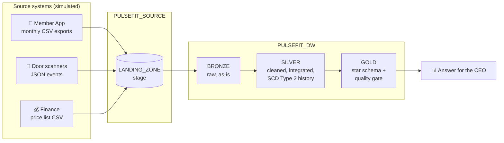

# 🏋️ PulseFit: build a data warehouse in Snowflake

A hands-on practical for the guest lecture **"Industrial Data Warehousing with Snowflake"**.
Students import a set of ready-made notebooks into a free Snowflake trial account and run them cell by cell.
**No coding is needed**: every cell is pre-written, and the notebooks explain what to look for and why it matters.

---

## The story

> It's **July 2026**. You've just joined **PulseFit**, a (fictional) chain of five fitness clubs in Sri Lanka,
> as their first data engineer. The CEO asks one question:
>
> **"Which members stopped visiting last quarter, and was it because of the price increase?"**

Nobody can answer, because the data is spread across three systems: the **Member App** (monthly CSV exports),
the **door scanners** (JSON check-in events) and **Finance** (an Excel price list). Over five notebooks, students
build PulseFit's first warehouse, layer by layer, and answer the question with data.

## The notebooks

| # | Notebook | Story beat | Concepts covered | Time |
|---|---|---|---|---|
| 01 | `01_Day1_Set_Up_Snowflake` | Day 1: get the keys, switch on the data feeds | 3-layer architecture, virtual warehouses & auto-suspend, databases & schemas, medallion layers, stages | ~15 min |
| 02 | `02_Bronze_Load_Raw_Data` | Bring the data in, exactly as it arrives | file formats, querying files in a stage, `COPY INTO`, `VARIANT` + JSON paths, `FLATTEN`, rerunnable loads, load history | ~15 min |
| 03 | `03_Silver_Gold_Transform_and_Model` | Clean it, connect it, model it | data profiling, de-duplication, time zones, ID integration, **SCD Type 2**, **star schema**, surrogate keys, point-in-time joins, **data-quality gate**, views | ~20 min |
| 04 | `04_Answer_the_CEO` | Answer the question, then look under the hood | star-schema queries, SCD Type 1 vs 2 (the lecture's "Nimal" example), charts, micro-partition **pruning**, **result cache**, **scaling a warehouse** | ~20 min |
| 05 | `05_Snowflake_Superpowers` | A very bad Monday | **Time Travel**, **UNDROP**, **zero-copy cloning**, role-based access control, secure data sharing & Marketplace, cost and storage | ~15 min |
| 99 | `99_Cleanup_Optional` | Remove everything | `DROP ... IF EXISTS` | 1 min |

Every notebook opens with a "you are here" progress bar and closes with **What you did**, **🤔 Think about it**
discussion questions, and a pointer to the next notebook. Concepts are linked to the lecture slide titles.

## What students need

* A **Snowflake free trial** account (any cloud and region; the trial gives Enterprise edition and free credits).
* A modern browser. Nothing to install.

Everything runs as `ACCOUNTADMIN`, the default role of a trial account. Notebook 05 explains why a real company
would use smaller roles, and creates one.

## How to run it

> The detailed, screenshot-level student guide is maintained separately. This is the short version.

1. **Get the notebooks.** Download this repository (**Code ▸ Download ZIP**) and unzip it. The files to import are in
   [`notebooks/`](notebooks/).
2. **Open Workspaces.** In Snowsight go to **Projects ▸ Workspaces ▸ My Workspace**.
3. **Upload** all the `.ipynb` files from `notebooks/` into your workspace.
4. **Open `01_Day1_Set_Up_Snowflake`** and connect it to compute when asked. The defaults are fine: the
   Snowflake-provided CPU compute pool, and `COMPUTE_WH` as the query warehouse. A short idle timeout (e.g. 1 hour)
   keeps costs down.
5. **Run the cells in order**, top to bottom, then continue with notebooks 02 ▸ 03 ▸ 04 ▸ 05.

New Snowflake accounts use **Notebooks in Workspaces** (the Jupyter-compatible notebook experience; accounts created
after April 2026 cannot create the older "legacy" notebooks). These files are written in that format: SQL cells use
the `%%sql` cell magic, and charts use Altair.

## Cost

A full run of notebooks 01–05 used **about 0.3 credits** on `PULSEFIT_WH` in testing, a small fraction of the
trial's free credits. Most of it is the 600-million-row scaling demo in notebook 04, which briefly resizes the
warehouse to Medium and back. The notebook's container service is billed separately while it runs, so stop it at the
end (or rely on the idle timeout). Storage for all PulseFit tables is about 20 MB.

## For instructors

### The data
There are no data files in this repo. Notebook 01 contains a **deterministic simulator** written in SQL
(`HASH()`-based, no `RANDOM()`), so **every student gets exactly the same data and the same numbers**.
It creates 2,400 members and about 210,000 door-scanner events for 1 Oct 2025 to 30 Jun 2026, unloads them as
CSV/JSON files to an internal stage, and from then on the notebooks treat those files as if they came from real
source systems.

Planted on purpose, so the notebooks have something to find:

| Planted | Discovered in | Teaches |
|---|---|---|
| Nimal Perera (member 1001) moves Kandy ➜ Colombo on 1 Mar 2026 | 03, 04 | SCD Type 2. Reproduces the lecture slide: Jan–Feb visits *Kandy 24 · Colombo 0* (Type 2) vs *Kandy 0 · Colombo 24* (Type 1) |
| Standard plan LKR 8,000 ➜ 9,500 from 1 Apr 2026 (announced 15 Mar); one third of Standard members stop coming | 04 | the CEO's answer |
| ~1.2% duplicate scanner events | 03 | de-duplication |
| 350 guest-pass scans with no member | 03 | integration / orphan records |
| Scanner timestamps in UTC (Sri Lanka is UTC+5:30), so a `checkins_2025-09` file appears | 02, 03 | time zones |
| Prices exported as text (`"8,000"`) with `DD/MM/YYYY` dates | 02, 03 | typing in silver, not bronze |
| ~10% of emails with capitals and stray spaces | 03 | cleaning |

### Expected results (identical for everyone)

| Check | Value |
|---|---|
| Bronze check-in events (incl. 2,421 duplicates and 350 guest scans) | 210,277 |
| Member check-ins in silver / rows in `FCT_CHECKIN` | 207,506 |
| Member versions in `MEMBER_HISTORY` (2,400 members) | 2,897 |
| Quality gate | 5 / 5 tests pass |
| Nimal, Jan–Feb visits | Type 2: Kandy 24 · Type 1: Colombo 24 |

**The answer (notebook 04):** active in Q1 2026, zero visits in Q2 2026, by plan on 31 March:

| Plan | Fee Q1 ➜ Q2 (LKR) | Active in Q1 | Stopped in Q2 | % stopped |
|---|---|---|---|---|
| STANDARD | 8,000 ➜ 9,500 | 942 | 369 | **39.2%** |
| BASIC | 5,500 ➜ 5,500 | 406 | 17 | 4.2% |
| STUDENT | 4,500 ➜ 4,500 | 429 | 14 | 3.3% |
| PREMIUM | 14,000 ➜ 14,000 | 400 | 12 | 3.0% |

Timings in notebook 04 Part B vary by run (order of magnitude on a Gen2 X-Small: ~7 s for TPC-H Q1 on 600M rows,
~2–3 s on Medium, well under a second from the result cache; pruning reads ~17 of ~1,000 micro-partitions).

### Re-running and recovering
* Every notebook can be re-run from the top. Notebook 01 rebuilds the landing zone, 02 recreates bronze (so
  `COPY INTO` loads everything again), and 03 rebuilds silver and gold.
* If a student runs the "mistake" cell in notebook 05 twice, Time Travel restores from the *second* delete. The fix
  is simply to re-run notebook 03.
* `UNDROP TABLE` in notebook 05 fails if run twice (the table already exists). That's harmless.
* `99_Cleanup_Optional` removes everything: `PULSEFIT_SOURCE`, `PULSEFIT_DW`, `PULSEFIT_DEV`, `PULSEFIT_WH`,
  the `PULSEFIT_ANALYST` role and the `PULSEFIT_PARTNER_SHARE` share.

### Objects created

| Object | Created in |
|---|---|
| Warehouse `PULSEFIT_WH` (X-Small, auto-suspend 60 s) | 01 |
| Database `PULSEFIT_SOURCE`, schema `LANDING`, stage `LANDING_ZONE` | 01 |
| Database `PULSEFIT_DW` with schemas `BRONZE`, `SILVER`, `GOLD` | 01 |
| Bronze tables `CLUBS`, `PRICE_LIST`, `MEMBER_SNAPSHOTS`, `CHECKIN_EVENTS`; file formats `FF_CSV`, `FF_JSON` | 02 |
| Silver tables `CLUBS`, `PLAN_PRICES`, `MEMBER_SNAPSHOTS`, `MEMBER_HISTORY`, `CHECKINS` | 03 |
| Gold tables `DIM_DATE`, `DIM_CLUB`, `DIM_PLAN`, `DIM_MEMBER`, `FCT_CHECKIN`; view `CHECKIN_DETAILS` | 03 |
| Clone `PULSEFIT_DEV`, role `PULSEFIT_ANALYST`, share `PULSEFIT_PARTNER_SHARE` | 05 |
